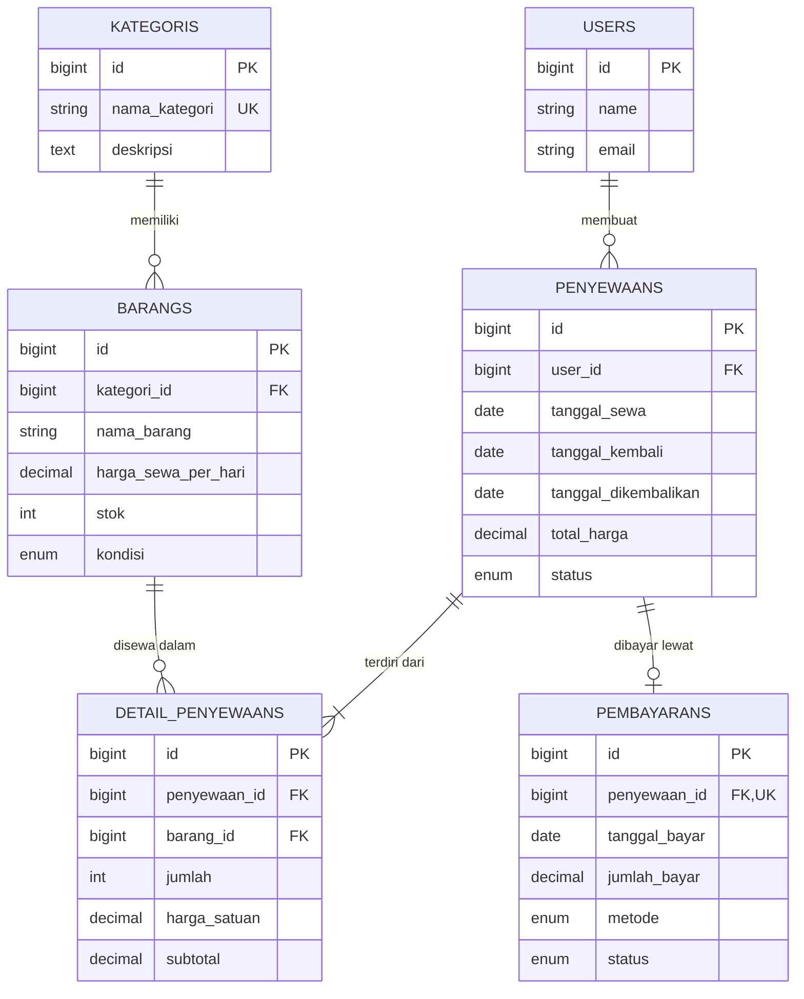

# PenyewaanCamp

PenyewaanCamp adalah aplikasi web penyewaan perlengkapan camping yang dibangun dengan **Laravel**, **Blade**, dan **Tailwind CSS**. Fokus tahap ini adalah **perancangan database dan relasi antar tabel** menggunakan Eloquent ORM.

## Fitur

- Pengelompokan barang berdasarkan kategori (tenda, carrier, alat masak, dll.)
- Data barang beserta stok, harga sewa per hari, dan kondisi
- Transaksi penyewaan oleh user dengan tanggal sewa dan tanggal kembali
- Satu penyewaan dapat memuat banyak barang beserta jumlah, harga satuan, dan subtotal
- Pencatatan pembayaran untuk setiap penyewaan

## Desain Database

ERD lengkap juga tersedia di [docs/erd.md](docs/erd.md).



### Struktur Tabel

| Tabel | Primary Key | Foreign Key | Atribut Lain |
|---|---|---|---|
| `users` | `id` | - | `name`, `email`, `password` |
| `kategoris` | `id` | - | `nama_kategori` (unique), `deskripsi` |
| `barangs` | `id` | `kategori_id` | `nama_barang`, `harga_sewa_per_hari`, `stok`, `kondisi` |
| `penyewaans` | `id` | `user_id` | `tanggal_sewa`, `tanggal_kembali`, `tanggal_dikembalikan`, `total_harga`, `status` |
| `detail_penyewaans` | `id` | `penyewaan_id`, `barang_id` | `jumlah`, `harga_satuan`, `subtotal` |
| `pembayarans` | `id` | `penyewaan_id` (unique) | `tanggal_bayar`, `jumlah_bayar`, `metode`, `status` |

### Relasi yang Tercakup

| Tipe | Contoh |
|---|---|
| One-to-One | `Penyewaan` ↔ `Pembayaran` |
| One-to-Many | `Kategori` → `Barang`, `User` → `Penyewaan`, `Penyewaan` → `DetailPenyewaan` |
| Many-to-Many dengan pivot | `Penyewaan` ↔ `Barang` melalui `detail_penyewaans` (`jumlah`, `harga_satuan`, `subtotal`) |
| Has-Many-Through | `User` → `DetailPenyewaan` melalui `Penyewaan` |

### Aturan Bisnis

- Satu user dapat membuat banyak penyewaan, tetapi setiap penyewaan dimiliki satu user.
- Satu penyewaan memuat banyak barang, dan satu barang dapat muncul di banyak penyewaan.
- Satu barang hanya muncul satu kali dalam satu penyewaan (unique `penyewaan_id` + `barang_id`).
- Setiap penyewaan memiliki paling banyak satu pembayaran.
- `harga_satuan` disimpan di detail agar perubahan harga barang tidak mengubah transaksi lama.
- Data kategori, barang, dan user tidak dapat dihapus jika sudah dipakai transaksi (`restrictOnDelete`).

## Tech Stack

- PHP 8.3+ dan Laravel
- Blade templates
- Tailwind CSS (via Vite)
- MySQL atau SQLite

## Cara Menjalankan

```bash
git clone https://github.com/maulidahasanah14/laravel5d
cd laravel5d
composer install
npm install
cp .env.example .env
php artisan key:generate
php artisan migrate:fresh --seed
npm run dev
php artisan serve
```

Kemudian buka <http://localhost:8000>.

## Struktur Proyek

```
app/Models/        Model Eloquent dan relasinya
database/
  migrations/      Definisi tabel
  seeders/         Data contoh
docs/
  erd.md           ERD sistem
  progress/        Laporan progres per fase
resources/views/   Template Blade
```

## Roadmap

- [x] Perancangan dan dokumentasi database (ERD)
- [x] Migration, model, relasi, dan seeder
- [ ] CRUD (Assignment 2)
- [ ] Transaksi penyewaan di antarmuka
- [ ] Perhitungan denda keterlambatan

## Penulis

Maulida Hasanah - NPM 2410010242

## Lisensi

Dirilis di bawah [MIT License](https://opensource.org/licenses/MIT).