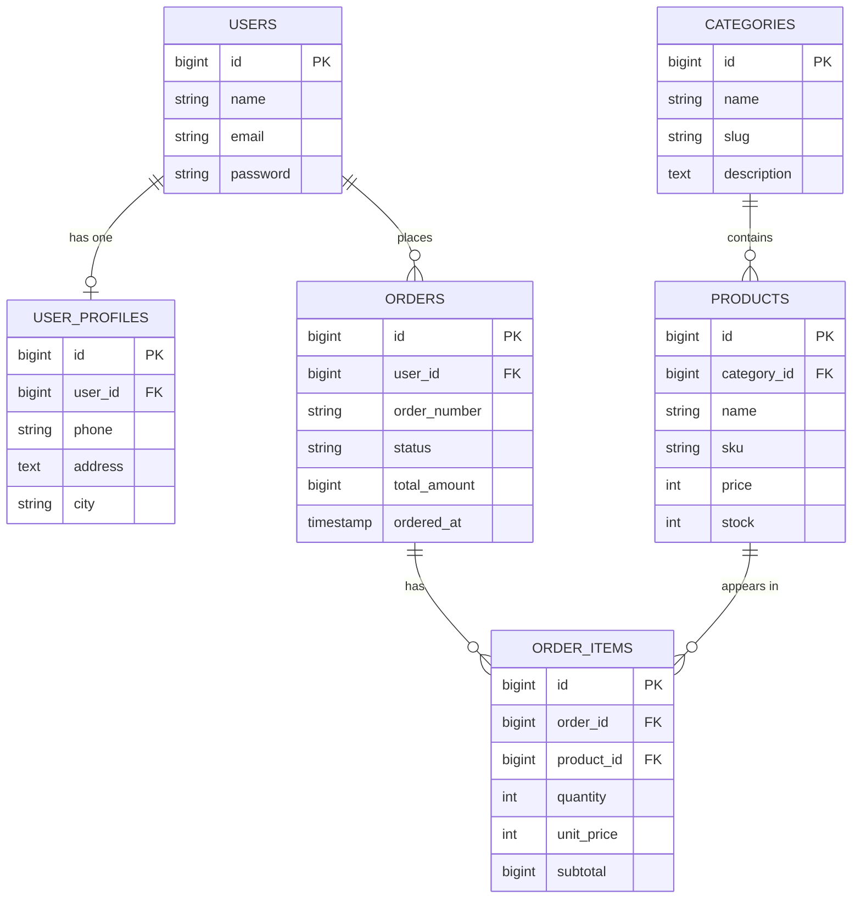

# Toko Online Mini

Toko Online Mini adalah aplikasi web e-commerce sederhana yang dibangun dengan **Laravel**. Fokus tugas ini adalah perancangan dan implementasi **relasi antar tabel basis data** menggunakan Eloquent ORM.

## Fitur Saat Ini

- Katalog produk yang dikelompokkan berdasarkan kategori
- Profil tambahan untuk setiap pengguna (telepon, alamat, kota)
- Pemesanan: satu pesanan berisi satu atau lebih produk lengkap dengan jumlah dan harga
- Harga produk disimpan pada setiap item pesanan sebagai harga saat transaksi
- Halaman dashboard, produk, dan pesanan (baca saja)

## Desain Basis Data



### Relasi yang Dicakup

| Jenis | Contoh |
|---|---|
| One-to-One | `User` ↔ `UserProfile` |
| One-to-Many | `Category` → `Product`, `User` → `Order`, `Order` → `OrderItem` |
| Many-to-Many dengan data pivot | `Order` ↔ `Product` melalui `order_items` (`quantity`, `unit_price`, `subtotal`) |
| Has-Many-Through | `User` → `OrderItem` melalui `Order` |

### Aturan Basis Data

- `order_number` pada pesanan dan `sku` pada produk harus unik.
- `user_profiles.user_id` bersifat unik, sehingga satu user hanya punya satu profil.
- `order_items` memiliki unique gabungan `(order_id, product_id)`.
- `unit_price` pada `order_items` adalah salinan harga produk saat pembelian, sehingga perubahan harga di kemudian hari tidak memengaruhi pesanan lama.
- Hapus pesanan akan menghapus item-nya (`cascadeOnDelete`). Kategori, produk, dan user yang masih dipakai tidak bisa dihapus (`restrictOnDelete`).

## Teknologi

- PHP 8.3+ dan Laravel
- MySQL atau SQLite

## Memulai

```bash
git clone https://github.com/nrhyti/laravel5d
cd laravel5d
composer install
cp .env.example .env
php artisan key:generate
# atur DB_* di .env, lalu:
php artisan migrate:fresh --seed
php artisan serve
```

## Struktur Project

```
app/Models/        Model Eloquent dan relasinya
database/
  migrations/      Definisi tabel
  seeders/         Data contoh
docs/progress/     Laporan progress per fase
```

## Roadmap

- [x] Perancangan dan dokumentasi basis data
- [x] Migration, model, dan seeder
- [x] Factory
- [ ] CRUD Periode dengan template AdminLTE (Assignment 2)

## Penulis

Norhayati, NPM 2410010025, TI 5D REG BJB

## Lisensi

Dirilis di bawah [Lisensi MIT](https://opensource.org/licenses/MIT).