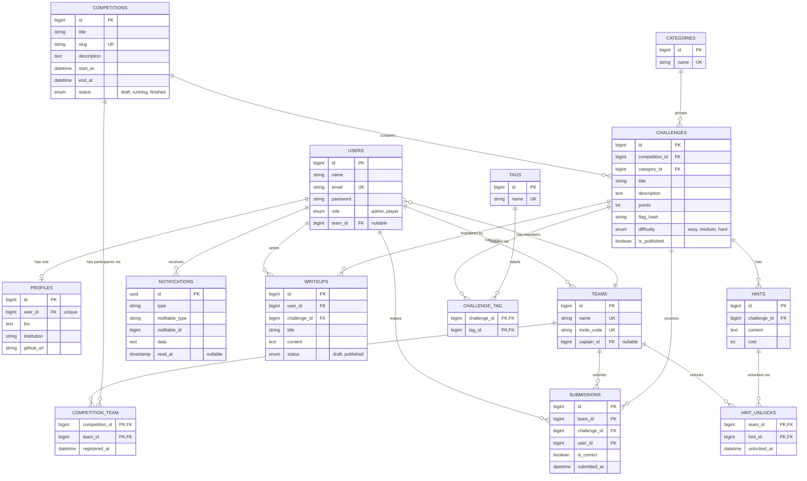

# Flagboard — CTF Competition Management Platform

Flagboard is a Capture The Flag (CTF) competition management web application built with **Laravel**, **Blade**, and **Tailwind CSS**. It is the final semester project for the *Object-Oriented Programming 2 (PBO2)* course, with a focus on designing and implementing **database table relationships** using Eloquent ORM.

## Features

- Create and manage CTF competitions with a start time, end time, and status
- Challenges grouped into six categories:
  Web, Cryptography, Forensics, Reverse Engineering, Pwn, and Miscellaneous
- Team system with invite codes; players join a team and compete together
- Team registration to competitions
- Flag submission per team; flags are stored as hashes, never in plain text
- Hints that cost points and can be unlocked per team
- Live scoreboard (points from solved challenges minus hint costs)
- Writeups written by players and linked to a challenge (draft or published)
- Tags for flexible challenge organization
- Role-based access: `admin` manages competitions and challenges, `player` participates
- Competition phases that follow the clock (upcoming, live, finished) with countdown timers
- Challenge board with search and filters, first blood badges, and solve counts
- Live scoreboard with a podium, a score-over-time chart, and automatic refresh
- Teams with a captain, a member limit, member management, a public directory, and team pages
- Dashboard with rank, progress, and team activity; a recent activity feed on the home and competition pages
- In-app notifications (teammate solves, first blood, team changes, role changes)
- Email verification and password reset (emails go to the log in local development)
- Writeups in Markdown with a live preview, search, and filters
- Admin area: overview with a chart, users and roles, teams, competitions, challenges, categories, and tags
- A playful sky blue and coral design that works on phones, tablets, and desktops
- Lots of demo data, so every page has something to show

## Database Design

The full schema and every relationship are documented with Mermaid diagrams in
[`docs/database/erd.md`](docs/database/erd.md).



### Relationships Covered

| Type | Example |
|---|---|
| One-to-One | `User` ↔ `Profile` |
| One-to-Many | `Team` → `User`, `Competition` → `Challenge`, `Category` → `Challenge`, `Challenge` → `Hint`, `Challenge` → `Writeup`, `User` → `Writeup` |
| Many-to-Many | `Challenge` ↔ `Tag` (`challenge_tag`) |
| Many-to-Many with pivot data | `Team` ↔ `Competition` (`registered_at`), `Team` ↔ `Challenge` via `submissions` (`is_correct`, `submitted_at`), `Team` ↔ `Hint` via `hint_unlocks` (`unlocked_at`) |
| Has-Many-Through | `Competition` → `Submission` through `Challenge` |

### Business Rules

- A team can have only one correct submission per challenge.
- Flags are compared using hash verification (`Hash::check`) against `challenges.flag_hash`.
- Team score = sum of `points` of solved challenges − sum of `cost` of unlocked hints.
- A team can only submit to challenges of a competition it is registered in, while the competition is running (between its start and end time).
- A team can register for a competition while it is upcoming or running. A draft competition is hidden from players, and the challenges unlock when the competition starts.
- Registering teams, submitting flags, unlocking hints, and writing writeups need a verified email address.
- A team has at most 4 players (`config/flagboard.php`). The creator is the captain. Only the captain can rename the team, renew the invite code, remove members, hand over the captain role, or disband the team.
- A team with submissions cannot be disbanded or deleted, because the scoreboards need its history.
- A hint cannot be unlocked twice, and not after the team has solved that challenge.
- A player can write a writeup for a challenge only after the player's team has solved it. A draft writeup is visible to its author only.
- Only `admin` users can create, edit, or delete competitions, challenges, and hints.

## Tech Stack

- PHP 8.3+ and Laravel
- Blade templates
- Tailwind CSS (via Vite)
- MySQL or SQLite

## Getting Started

```bash
# Clone the repository
git clone https://github.com/deadyiss/laravel5d.git
cd laravel5d

# Install dependencies
composer install
npm install

# Configure the environment
cp .env.example .env
php artisan key:generate

# Create the schema and seed the categories
php artisan migrate --seed

# Start the development servers
npm run dev
php artisan serve
```

Then open <http://localhost:8000>.

### Demo accounts

`php artisan migrate --seed` fills the application with demo data: 14 teams and about 40 players, 5 competitions (one live, one upcoming, two finished, one draft), 53 challenges with hints and tags, more than 700 submissions spread over time, writeups in Markdown, and notifications.

| Role | Email | Password |
|---|---|---|
| Admin | `admin@example.com` | `password` |
| Player, captain of Null Pointers | `player@example.com` | `password` |
| Player, member of Null Pointers | `member@example.com` | `password` |
| Player without a team | `solo@example.com` | `password` |
| Player with an unverified email | `unverified@example.com` | `password` |

The flag of every challenge is `FLAG{demo_<challenge id>}`, for example `FLAG{demo_1}` for the challenge with id 1. The id is the last number in the address of the challenge page (`/challenges/1`).

### Pages

| Page | Who |
|---|---|
| `/`, `/competitions`, `/competitions/{id}`, `/competitions/{id}/scoreboard`, `/teams`, `/teams/{id}`, `/writeups` | everyone |
| `/register`, `/login`, `/forgot-password` | guests |
| `/dashboard`, `/team`, `/profile`, `/notifications`, challenge pages | signed-in players |
| Registering, flag submission, hints, writeup forms | signed-in players with a verified email |
| `/admin`, `/admin/competitions`, `/admin/challenges`, `/admin/users`, `/admin/teams`, `/admin/categories`, `/admin/tags` | `admin` only |

### Running the tests

```bash
php artisan test
```

The feature tests cover authentication, roles, teams, competition registration, flag submission, hints, the scoreboard, writeups, and the admin pages.

## Project Structure

```
app/Http/Controllers/  Page controllers (Admin/ for the admin area)
app/Http/Middleware/   Role check for admin pages
app/Services/      Scoreboard, activity feed, and team participation rules
app/Notifications/ In-app notifications
config/flagboard.php  Team size and feed settings
app/Models/        Eloquent models and relationships
database/
  migrations/      Table definitions
  factories/       Fake data generators
  seeders/         Categories and sample data
resources/views/   Blade templates (components/ holds the design system)
resources/js/      Alpine.js and Chart.js behaviour
routes/web.php      All routes
tests/Feature/     Feature tests
docs/
  database/        ERD and relationship documentation
  progress/        Phase tracker (P01, P02, P03, ...)
```

## Roadmap

- [x] Database design and documentation
- [x] Migrations, models, factories, and seeders
- [x] Authentication and role-based access
- [x] Team management and competition registration
- [x] Challenge CRUD and flag submission
- [x] Hints and scoreboard
- [x] Writeups
- [x] Redesign with a playful sky blue and coral look
- [x] Email verification, password reset, notifications, and user management
- [x] Competition phases with countdown, live scoreboard with chart, and a full set of demo data

## Author

Dhea Arimbi Almalita — NPM 2410010187

## License

Released under the [MIT License](https://opensource.org/licenses/MIT).
