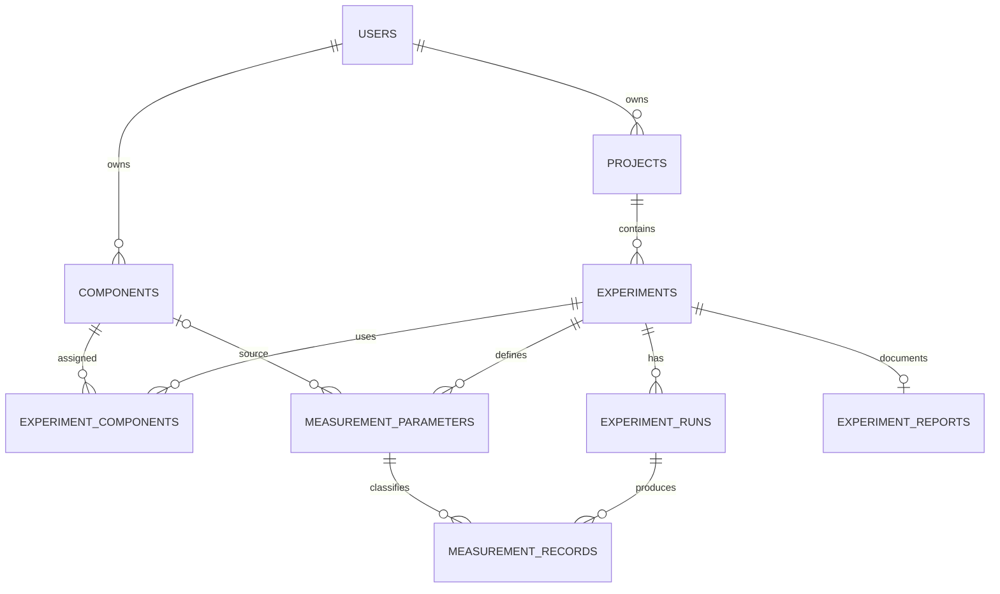

# ProtoLog — Database Design

## 1. System Overview

ProtoLog is a personal engineering experiment journal for documenting robotics, embedded systems, and IoT development activities.

The application helps an engineer organize engineering projects, maintain a personal hardware inventory, document experiments, record hardware configurations, track test executions, and evaluate measurement results.

The system is designed for individual use. Components can be reused across multiple experiments, while every experiment run and its measurement results are recorded for future reference.

## 2. Database Scope

The database uses the existing Laravel `users` table to identify the owner of projects and hardware components.

ProtoLog introduces eight domain tables:

| No. | Table | Description |
|---|---|---|
| 1 | projects | Stores personal engineering projects |
| 2 | components | Stores personally owned hardware components |
| 3 | experiments | Stores experiments belonging to projects |
| 4 | experiment_components | Records components and their configurations in experiments |
| 5 | experiment_runs | Stores individual executions of experiments |
| 6 | measurement_parameters | Defines parameters measured in experiments |
| 7 | measurement_records | Stores actual measurement results |
| 8 | experiment_reports | Stores experiment summaries and conclusions |

Existing Laravel tables, including `users`, `password_reset_tokens`, `sessions`, `cache`, `jobs`, and `periode`, are retained and are not duplicated.

## 3. Entity Attributes

### 3.1 Users

Existing Laravel table.

| Attribute | Type | Constraint |
|---|---|---|
| id | BIGINT | Primary Key |
| name | VARCHAR | NOT NULL |
| email | VARCHAR | UNIQUE, NOT NULL |
| password | VARCHAR | NOT NULL |
| created_at | TIMESTAMP | |
| updated_at | TIMESTAMP | |

### 3.2 Projects

Stores engineering projects owned by a user.

| Attribute | Type | Constraint |
|---|---|---|
| id | BIGINT | Primary Key |
| user_id | BIGINT | Foreign Key → users.id |
| name | VARCHAR | NOT NULL |
| domain | VARCHAR | NOT NULL |
| objective | TEXT | NULL |
| description | TEXT | NULL |
| status | VARCHAR | NOT NULL, DEFAULT 'planned' |
| started_on | DATE | NULL |
| completed_on | DATE | NULL |
| created_at | TIMESTAMP | |
| updated_at | TIMESTAMP | |

Examples of project domains include robotics, embedded systems, electronics, and IoT.

### 3.3 Components

Stores personally owned electronic and hardware components.

One record represents a component type or model, with its ownership quantity recorded in `quantity_owned`.

| Attribute | Type | Constraint |
|---|---|---|
| id | BIGINT | Primary Key |
| user_id | BIGINT | Foreign Key → users.id |
| name | VARCHAR | NOT NULL |
| category | VARCHAR | NOT NULL |
| manufacturer | VARCHAR | NULL |
| model | VARCHAR | NULL |
| interface | VARCHAR | NULL |
| specifications | JSON | NULL |
| quantity_owned | UNSIGNED INTEGER | NOT NULL, DEFAULT 1 |
| storage_location | VARCHAR | NULL |
| notes | TEXT | NULL |
| created_at | TIMESTAMP | |
| updated_at | TIMESTAMP | |

Examples include ESP32 boards, ultrasonic sensors, motor drivers, DC motors, and electronic modules.

### 3.4 Experiments

Stores experiments conducted within an engineering project.

| Attribute | Type | Constraint |
|---|---|---|
| id | BIGINT | Primary Key |
| project_id | BIGINT | Foreign Key → projects.id |
| title | VARCHAR | NOT NULL |
| objective | TEXT | NOT NULL |
| hypothesis | TEXT | NULL |
| procedure | TEXT | NULL |
| status | VARCHAR | NOT NULL, DEFAULT 'planned' |
| notes | TEXT | NULL |
| created_at | TIMESTAMP | |
| updated_at | TIMESTAMP | |

### 3.5 Experiment Components

Pivot table connecting experiments and components.

It records which components are used in an experiment and how they are configured.

| Attribute | Type | Constraint |
|---|---|---|
| id | BIGINT | Primary Key |
| experiment_id | BIGINT | Foreign Key → experiments.id |
| component_id | BIGINT | Foreign Key → components.id |
| quantity_used | UNSIGNED INTEGER | NOT NULL |
| role | VARCHAR | NOT NULL |
| connection_details | JSON | NULL |
| notes | TEXT | NULL |
| created_at | TIMESTAMP | |
| updated_at | TIMESTAMP | |

A unique constraint is applied to the combination of `experiment_id` and `component_id`.

`quantity_used` records the number of physical units used in the experiment. It does not automatically reduce the ownership quantity because components can be reused.

### 3.6 Experiment Runs

Stores individual executions of an experiment.

An experiment can have multiple runs, allowing the user to compare repeated tests under different conditions.

| Attribute | Type | Constraint |
|---|---|---|
| id | BIGINT | Primary Key |
| experiment_id | BIGINT | Foreign Key → experiments.id |
| run_number | UNSIGNED INTEGER | NOT NULL |
| status | VARCHAR | NOT NULL |
| firmware_version | VARCHAR | NULL |
| firmware_revision | VARCHAR | NULL |
| started_at | TIMESTAMP | NULL |
| completed_at | TIMESTAMP | NULL |
| environment_conditions | JSON | NULL |
| notes | TEXT | NULL |
| created_at | TIMESTAMP | |
| updated_at | TIMESTAMP | |

A unique constraint is applied to the combination of `experiment_id` and `run_number`.

### 3.7 Measurement Parameters

Defines parameters measured during an experiment.

A parameter may optionally reference the component used as its measurement source.

| Attribute | Type | Constraint |
|---|---|---|
| id | BIGINT | Primary Key |
| experiment_id | BIGINT | Foreign Key → experiments.id |
| source_component_id | BIGINT | Nullable Foreign Key → components.id |
| name | VARCHAR | NOT NULL |
| symbol | VARCHAR | NULL |
| unit | VARCHAR | NOT NULL |
| description | TEXT | NULL |
| created_at | TIMESTAMP | |
| updated_at | TIMESTAMP | |

Examples include distance, voltage, current, temperature, latency, and rotational speed.

### 3.8 Measurement Records

Stores measurement results produced by individual experiment runs.

| Attribute | Type | Constraint |
|---|---|---|
| id | BIGINT | Primary Key |
| experiment_run_id | BIGINT | Foreign Key → experiment_runs.id |
| measurement_parameter_id | BIGINT | Foreign Key → measurement_parameters.id |
| sample_no | UNSIGNED INTEGER | NOT NULL |
| measured_value | DECIMAL(15,6) | NOT NULL |
| reference_value | DECIMAL(15,6) | NULL |
| measured_at | TIMESTAMP | NULL |
| notes | TEXT | NULL |
| created_at | TIMESTAMP | |
| updated_at | TIMESTAMP | |

A unique constraint is applied to the combination of `experiment_run_id`, `measurement_parameter_id`, and `sample_no`.

### 3.9 Experiment Reports

Stores the final summary and evaluation of an experiment.

| Attribute | Type | Constraint |
|---|---|---|
| id | BIGINT | Primary Key |
| experiment_id | BIGINT | UNIQUE Foreign Key → experiments.id |
| summary | TEXT | NOT NULL |
| conclusion | TEXT | NOT NULL |
| limitations | TEXT | NULL |
| recommendations | TEXT | NULL |
| generated_at | TIMESTAMP | NULL |
| created_at | TIMESTAMP | |
| updated_at | TIMESTAMP | |

Each experiment can have at most one final report.

## 4. Entity Relationship Diagram

## 5. Relationship Description

| Relationship | Type | Description |
|---|---|---|
| User → Projects | One-to-Many | A user can own multiple projects |
| User → Components | One-to-Many | A user can own multiple component records |
| Project → Experiments | One-to-Many | A project can contain multiple experiments |
| Experiments ↔ Components | Many-to-Many | An experiment can use multiple components, and components can be reused in different experiments |
| Experiment → Experiment Runs | One-to-Many | An experiment can have multiple execution records |
| Experiment → Measurement Parameters | One-to-Many | An experiment can define multiple measurement parameters |
| Component → Measurement Parameters | One-to-Many, optional | A component can be the source of multiple measurement parameters |
| Experiment Run → Measurement Records | One-to-Many | A run can produce multiple measurement records |
| Measurement Parameter → Measurement Records | One-to-Many | A parameter can have multiple recorded measurements |
| Experiment → Experiment Report | One-to-One | An experiment can have at most one report |

### Additional Eloquent Relationship

Project → Experiment Runs through Experiments.

This relationship can be implemented using Laravel's `HasManyThrough` relationship.

## 6. Data Integrity Rules

1. Every project must belong to one user.
2. Every component record must belong to one user.
3. Every experiment must belong to one project.
4. A component cannot be recorded twice in the same experiment.
5. `quantity_owned` must be at least 1.
6. `quantity_used` must be at least 1.
7. The quantity used in an experiment must not exceed the component ownership quantity at the time the usage is recorded.
8. Component usage is historical information. The ownership quantity is not automatically reduced because physical components can be reused.
9. An experiment run number must be unique within its experiment.
10. A measurement sample number must be unique for each run and parameter combination.
11. A measurement parameter and its experiment run must belong to the same experiment.
12. An experiment can have at most one final report.
13. An experiment can only use components owned by the same user who owns its project.
14. If a measurement parameter references a source component, that component must be included in the same experiment through experiment_components.

Cross-table rules, such as checking the ownership quantity and matching the experiment of a measurement parameter with its run, must also be validated by the application.

## 7. Database Design Notes

- The database uses MySQL.
- The existing Laravel `users` table is reused.
- New tables use Laravel's `id()` convention for primary keys.
- Foreign keys use Laravel's `foreignId()` convention.
- Timestamps are maintained using Laravel's `timestamps()` convention.
- JSON columns store flexible hardware specifications and connection configurations.
- Decimal values are used for measurement results to preserve numerical precision.
- Components are recorded as reusable personal inventory.
- Experiment runs preserve the history of repeated tests.
- Existing Laravel migrations are retained and are not duplicated.
