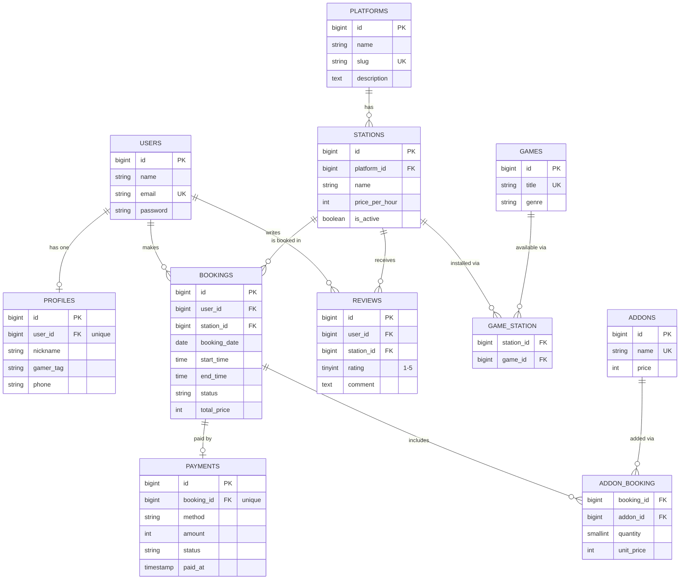

# Database Design: Entity Relationship Diagram

This document describes the database schema of **GameBook**, a gaming session booking application, and every Eloquent relationship used in the project.

## 1. Entity Relationship Diagram

## 2. Relationship Summary

| Type                      | Relationship                                                        | Eloquent                      |
| ------------------------- | ------------------------------------------------------------------- | ----------------------------- |
| One-to-One                | `User` and `Profile`                                                | `hasOne` / `belongsTo`        |
| One-to-One                | `Booking` and `Payment`                                             | `hasOne` / `belongsTo`        |
| One-to-Many               | `Platform` to `Station`                                             | `hasMany` / `belongsTo`       |
| One-to-Many               | `Station` to `Booking`                                              | `hasMany` / `belongsTo`       |
| One-to-Many               | `User` to `Booking`                                                 | `hasMany` / `belongsTo`       |
| One-to-Many               | `User` to `Review`, `Station` to `Review`                           | `hasMany` / `belongsTo`       |
| Many-to-Many              | `Station` and `Game` (pivot `game_station`)                         | `belongsToMany`               |
| Many-to-Many + pivot data | `Booking` and `Addon` (pivot `addon_booking`: `quantity`, `unit_price`) | `belongsToMany` + `withPivot` |
| Has-Many-Through          | `Platform` to `Booking` through `Station`                           | `hasManyThrough`              |
| Has-Many-Through          | `User` to `Payment` through `Booking`                               | `hasManyThrough`              |

## 3. Design Notes

- **Unique constraints:** `profiles.user_id`, `payments.booking_id`, `platforms.slug`, `games.title`, `addons.name`, and (`reviews.user_id`, `reviews.station_id`) so a user reviews a station only once.
- **Cascade rules:** deleting a user removes their profile, bookings, payments, and reviews. Deleting a platform or a station is restricted while bookings or stations still use it.
- **Pivot tables:** `game_station` and `addon_booking` use a composite primary key. `addon_booking` also stores the `quantity` and the `unit_price` at the time of booking.
