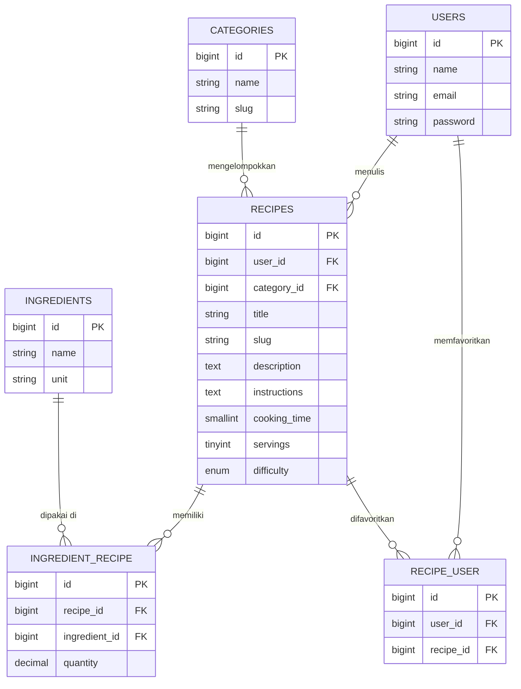

# ERD MasakApa

Entity Relationship Diagram untuk database aplikasi MasakApa (P01: Database Design).

## Keterangan Relasi

| Relasi | Jenis | Foreign key / pivot |
|---|---|---|
| `users` ke `recipes` | One-to-many | `recipes.user_id` |
| `categories` ke `recipes` | One-to-many | `recipes.category_id` |
| `recipes` dan `ingredients` | Many-to-many | pivot `ingredient_recipe` (kolom tambahan: `quantity`) |
| `users` dan `recipes` (favorit) | Many-to-many | pivot `recipe_user` |
