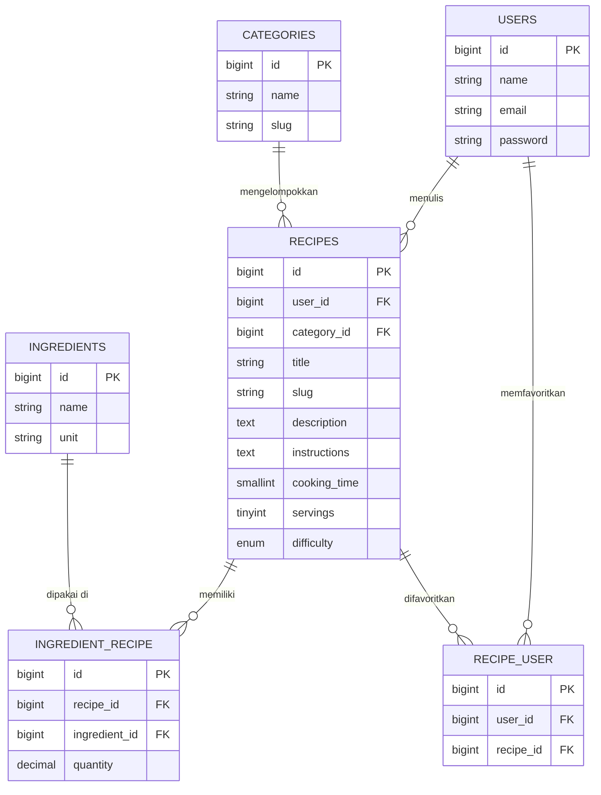

# Judul PR

```
[Assignment 1] Table Relationships: MasakApa - Nazwa Aulia Rizka - NPM 2410010338 - Kelas 5D TI Reguler Banjarbaru
```

# Deskripsi PR (salin isi di bawah garis ini ke GitHub)

---

## Assignment

**Assignment 1: Table Relationships: MasakApa**

| | |
|---|---|
| Student | Nazwa Aulia Rizka |
| NPM | 2410010338 |
| Class | 5D TI Reguler Banjarbaru |
| Phase | P01: Database Design |
| Status | Done (1 November 2026) |
| Fork / branch | [nazwaaa0805/laravel5d](https://github.com/nazwaaa0805/laravel5d) / `feature/p01-database-design` |

## What was done

| Job | Description | Status |
|---|---|---|
| J1 | Menganalisis kebutuhan data dan menentukan entitas MasakApa | Done |
| J2 | Membuat migration `categories`, `ingredients`, `recipes` | Done |
| J3 | Membuat pivot table `ingredient_recipe` dan `recipe_user` beserta foreign key dan unique constraint | Done |
| J4 | Membuat model `Category`, `Ingredient`, `Recipe` dan relasi pada `User` | Done |
| J5 | Membuat seeder data contoh (kategori, bahan, resep, favorit) | Done |
| J6 | Membuat ERD dan dokumentasi desain database | Done |

## ERD



Detail ERD: [docs/erd.md](https://github.com/nazwaaa0805/laravel5d/blob/feature/p01-database-design/docs/erd.md)

## Proof

- Progress report: [docs/progress/p01-database-design.md](https://github.com/nazwaaa0805/laravel5d/blob/feature/p01-database-design/docs/progress/p01-database-design.md)
- ERD: [docs/erd.md](https://github.com/nazwaaa0805/laravel5d/blob/feature/p01-database-design/docs/erd.md)
- Migration: [database/migrations](https://github.com/nazwaaa0805/laravel5d/tree/feature/p01-database-design/database/migrations)
- Model: [app/Models](https://github.com/nazwaaa0805/laravel5d/tree/feature/p01-database-design/app/Models)
- Seeder: [database/seeders](https://github.com/nazwaaa0805/laravel5d/tree/feature/p01-database-design/database/seeders)
- Commit: <tempel link commit>

## How to verify

```bash
git checkout feature/p01-database-design
composer install
cp .env.example .env
php artisan key:generate
# atur koneksi database di .env, lalu:
php artisan migrate:fresh --seed
php artisan tinker
```

Cek relasi di tinker:

```php
App\Models\User::first()->recipes;
App\Models\User::first()->favoriteRecipes;
App\Models\Category::first()->recipes;
App\Models\Recipe::with('ingredients', 'category', 'user')->first();
```

Migration dan seeder berjalan tanpa error, relasi mengembalikan data.

## Not done yet

- Controller, route, dan tampilan (fase berikutnya)
- Validasi input dan autentikasi
- Fitur pencarian resep berdasarkan bahan yang tersedia
