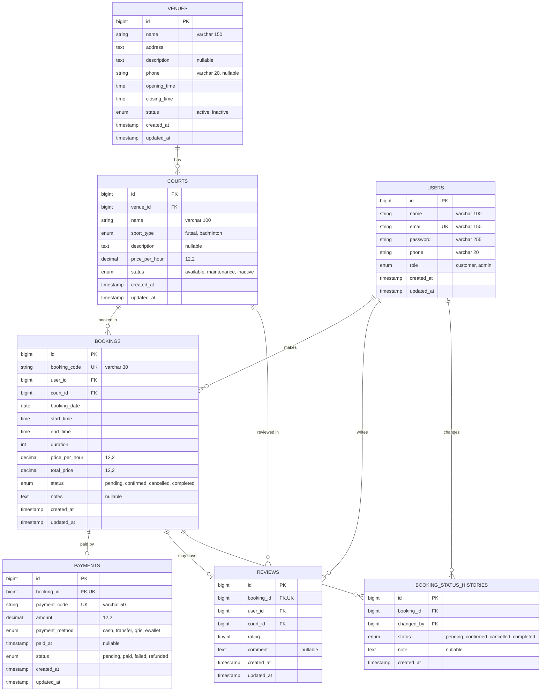

# Database Design — Entity Relationship Diagram

This document describes the database schema of **Web Booking Lapangan Olahraga** (sports court booking) and every Eloquent relationship used in the project.

## 1. Entity Relationship Diagram

## 2. Relationship Summary

| Type | Relationship | Eloquent |
|---|---|---|
| One-to-One (optional) | `Booking` ↔ `Payment` | `hasOne` / `belongsTo` |
| One-to-One (optional) | `Booking` ↔ `Review` | `hasOne` / `belongsTo` |
| One-to-Many | `Venue` → `Court` | `hasMany` / `belongsTo` |
| One-to-Many | `Court` → `Booking` | `hasMany` / `belongsTo` |
| One-to-Many | `Court` → `Review` | `hasMany` / `belongsTo` |
| One-to-Many | `User` → `Booking` | `hasMany` / `belongsTo` |
| One-to-Many | `User` → `Review` | `hasMany` / `belongsTo` |
| One-to-Many | `User` → `BookingStatusHistory` (via `changed_by`) | `hasMany` / `belongsTo` |
| One-to-Many | `Booking` → `BookingStatusHistory` | `hasMany` / `belongsTo` |
| Has-Many-Through | `Venue` → `Booking` through `Court` | `hasManyThrough` |
| Has-Many-Through | `Venue` → `Review` through `Court` | `hasManyThrough` |

## 3. Enum Values

| Table | Column | Values |
|---|---|---|
| `users` | `role` | `customer`, `admin` |
| `venues` | `status` | `active`, `inactive` |
| `courts` | `sport_type` | `futsal`, `badminton` |
| `courts` | `status` | `available`, `maintenance`, `inactive` |
| `bookings` | `status` | `pending`, `confirmed`, `cancelled`, `completed` |
| `booking_status_histories` | `status` | `pending`, `confirmed`, `cancelled`, `completed` |
| `payments` | `payment_method` | `cash`, `transfer`, `qris`, `ewallet` |
| `payments` | `status` | `pending`, `paid`, `failed`, `refunded` |

## 4. Design Notes

- **Unique constraints:** `users.email`, `bookings.booking_code`, `payments.booking_id`, `payments.payment_code`, and `reviews.booking_id`.
- **One payment per booking:** `payments.booking_id` is unique, so a booking has at most one payment record.
- **One review per booking:** `reviews.booking_id` is unique, so a customer can review a booking only once.
- **Price snapshot:** `bookings.price_per_hour` copies `courts.price_per_hour` at booking time, so later price changes do not affect existing bookings. `total_price` = `price_per_hour` × `duration`.
- **Status history:** every change of `bookings.status` is logged in `booking_status_histories`, with `changed_by` pointing to the user (customer or admin) who made the change.
- **Double-booking prevention:** overlapping bookings for the same `court_id`, `booking_date`, and time range must be checked in the application layer (or with a composite index plus a transaction), since a simple unique constraint cannot express time overlap.
- **Cascade rules (recommended):** deleting a venue is restricted while courts still exist; deleting a court is restricted while bookings still exist; deleting a booking cascades to its payment, review, and status histories.