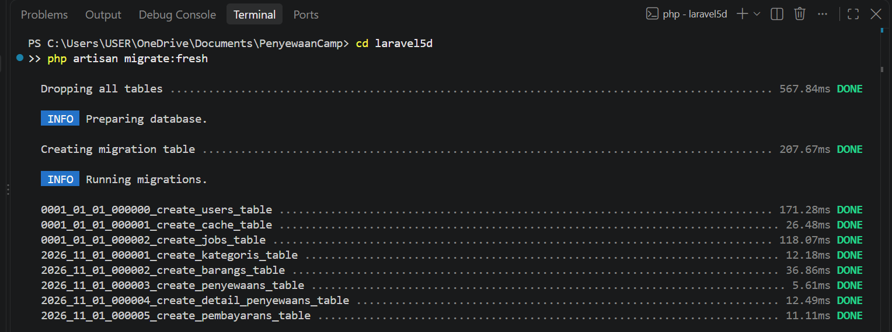
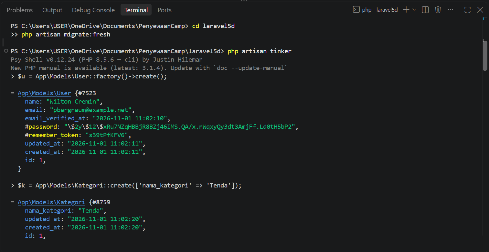
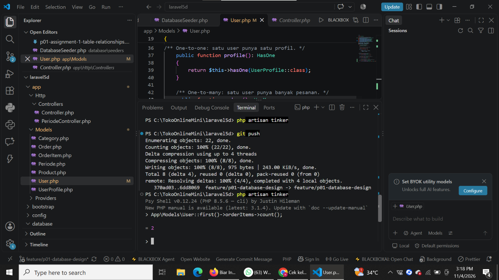

# P01: Database Design and Table Relationships

| | |
|---|---|
| **Status** | ✅ Done |
| **Started** | 2026-11-01 |
| **Completed** | 2026-11-04 |
| **Branch** | `feature/p01-database-design` |
| **Pull request** | [mirzayogy#57](https://github.com/mirzayogy/laravel5d/pull/57) |

## Goal

Design and implement the database of **Toko Online Mini** with Eloquent relationships: One-to-One, One-to-Many, Many-to-Many (with pivot data), and Has-Many-Through.

## Jobs

| Code | Job | Status | Completed | Proof |
|---|---|---|---|---|
| J1 | Database design and ERD | ✅ Done | 2026-11-01 | [README ERD](https://github.com/nrhyti/laravel5d/blob/feature/p01-database-design/README.md#desain-basis-data) |
| J2 | Migrations and constraints | ✅ Done | 2026-11-01 | [migrations](https://github.com/nrhyti/laravel5d/tree/feature/p01-database-design/database/migrations), [commit 370ad03](https://github.com/nrhyti/laravel5d/commit/370ad03) |
| J3 | Models and relationships | ✅ Done | 2026-11-04 | [models](https://github.com/nrhyti/laravel5d/tree/feature/p01-database-design/app/Models), [commit d6d3740](https://github.com/nrhyti/laravel5d/commit/d6d3740) |
| J4 | Seeder | ✅ Done | 2026-11-01 | [TokoOnlineSeeder.php](https://github.com/nrhyti/laravel5d/blob/feature/p01-database-design/database/seeders/TokoOnlineSeeder.php) |
| J5 | Sync with upstream | ✅ Done | 2026-11-04 | [commit 6dd8069](https://github.com/nrhyti/laravel5d/commit/6dd8069) |
| J6 | README | ✅ Done | 2026-11-04 | [README.md](https://github.com/nrhyti/laravel5d/blob/feature/p01-database-design/README.md), [commit 72a955a](https://github.com/nrhyti/laravel5d/commit/72a955a) |

**Status legend:** ⏳ Planned · 🚧 In progress · ✅ Done · ⛔ Blocked

---

### J1: Database design and ERD

- **Status:** ✅ Done, 2026-11-01
- **What:** 6 tables: `users`, `user_profiles`, `categories`, `products`, `orders`, `order_items`. `order_items` is the pivot between orders and products and stores `quantity`, `unit_price`, and `subtotal`.
- **Proof:** the ERD (Mermaid) and relationship table in the [README](https://github.com/nrhyti/laravel5d/blob/feature/p01-database-design/README.md#desain-basis-data).

### J2: Migrations and constraints

- **Status:** ✅ Done, 2026-11-01
- **What:** 5 table migrations with foreign keys and rules:
  - `cascadeOnDelete` on `order_items.order_id` and `user_profiles.user_id`.
  - `restrictOnDelete` on `products.category_id`, `orders.user_id`, and `order_items.product_id`.
  - Unique constraints: `user_profiles.user_id`, `categories.name`, `categories.slug`, `products.sku`, `orders.order_number`, and `order_items(order_id, product_id)`.
  - `unit_price` is stored in `order_items` so price history stays correct when a product price changes.
- **Proof:** [migrations](https://github.com/nrhyti/laravel5d/tree/feature/p01-database-design/database/migrations), [commit 370ad03](https://github.com/nrhyti/laravel5d/commit/370ad03)
- **Verified:** `php artisan migrate:fresh --seed` runs without errors.



### J3: Models and relationships

- **Status:** ✅ Done, 2026-11-04
- **What:**

| Relationship | Type | Implementation |
|---|---|---|
| User - UserProfile | One-to-One | `hasOne` / `belongsTo` |
| User - Order | One-to-Many | `hasMany` / `belongsTo` |
| Category - Product | One-to-Many | `hasMany` / `belongsTo` |
| Order - OrderItem | One-to-Many | `hasMany` / `belongsTo` |
| Order - Product | Many-to-Many | `belongsToMany` through `order_items` with `withPivot(quantity, unit_price, subtotal)` |
| User - OrderItem | Has-Many-Through | `User::orderItems()` through `Order` |

- **Proof:** [models](https://github.com/nrhyti/laravel5d/tree/feature/p01-database-design/app/Models), [commit d6d3740](https://github.com/nrhyti/laravel5d/commit/d6d3740)
- **Verified:** through tinker on the seeded data.





- **Not done:** automated tests.

### J4: Seeder

- **Status:** ✅ Done, 2026-11-01
- **What:** `TokoOnlineSeeder` creates 3 categories, 6 products, 2 users with profiles, and 2 orders with items. Order totals are calculated from the items. `DatabaseSeeder` calls `PeriodeSeeder` (from the lecturer) and `TokoOnlineSeeder`.
- **Proof:** [seeders](https://github.com/nrhyti/laravel5d/tree/feature/p01-database-design/database/seeders)
- **Not done:** factories for the new models.

### J5: Sync with upstream

- **Status:** ✅ Done, 2026-11-04
- **What:** Merged `upstream/main` (lecturer's Periode model, migration, and seeder) into the branch and resolved the conflict in `DatabaseSeeder.php`. The pull request now has no conflicts.
- **Proof:** [commit 6dd8069](https://github.com/nrhyti/laravel5d/commit/6dd8069)
- **Verified:** `php artisan migrate:fresh --seed` runs without errors and `Periode::count()` returns 4.

### J6: README

- **Status:** ✅ Done, 2026-11-04
- **What:** Rewrote the README so it matches the implemented schema: features, ERD, relationship table, database rules, setup steps, and roadmap.
- **Proof:** [README.md](https://github.com/nrhyti/laravel5d/blob/feature/p01-database-design/README.md), [commit 72a955a](https://github.com/nrhyti/laravel5d/commit/72a955a)

---

## How to verify

```bash
git checkout feature/p01-database-design
composer install
cp .env.example .env
php artisan key:generate
# set DB_* in .env, then:
php artisan migrate:fresh --seed
php artisan tinker
```

Example checks in tinker (based on the seeded data):

```php
App\Models\User::first()->profile->city;      // "Banjarmasin"
App\Models\Order::first()->total_amount;      // 175000
App\Models\User::first()->orderItems->count(); // 2
```

## Next

- Factories for the new models.
- P02: CRUD Periode with the AdminLTE template (Assignment 2), in its own file `P02-crud-periode.md`.