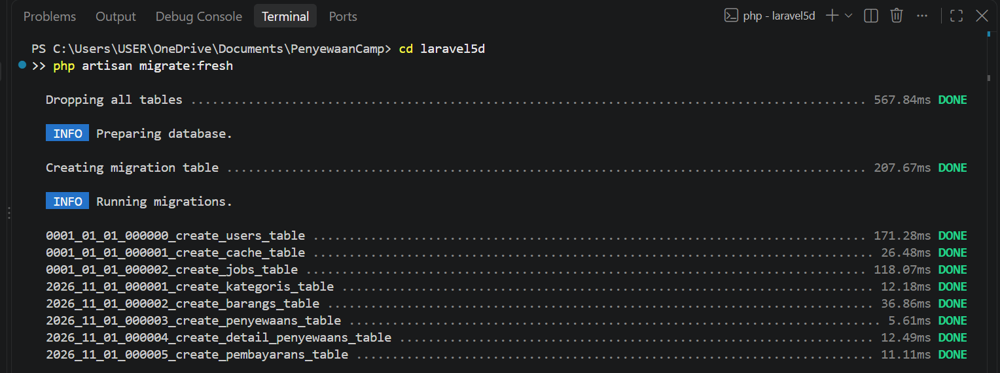
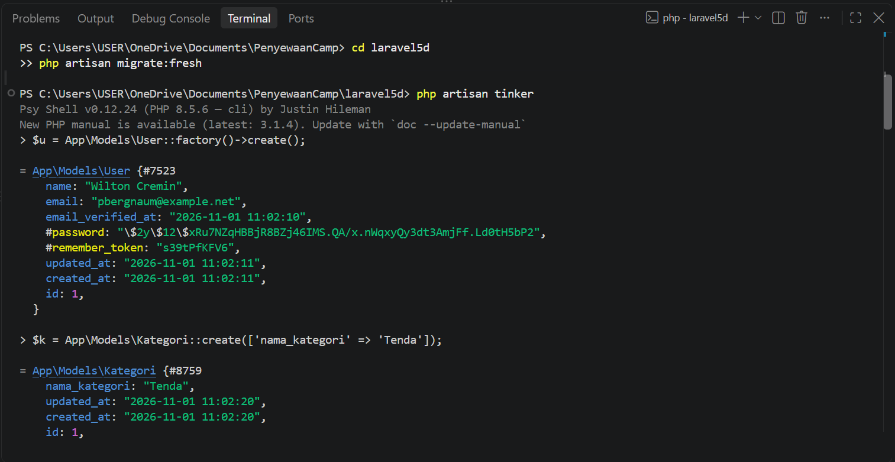

# P01: Database Design

| | |
|---|---|
| **Status** | ✅ Done |
| **Started** | 2026-10-30 |
| **Completed** | 2026-11-04 |
| **Branch** | `feature/p01-database-design` |
| **Pull request** | [#56](https://github.com/mirzayogy/laravel5d/pull/56) |

| | |
|---|---|
| **Student** | Maulida Hasanah |
| **NPM** | 2410010242 |
| **Class** | TI 5D REG BJB |
| **Assignment** | Assignment 1: Table Relationships (PenyewaanCamp) |

## Goal

Design the database of PenyewaanCamp (camping equipment rental) with its table relationships, then implement it as Laravel migrations, Eloquent models, and seeders.

## Jobs

| Code | Job | Status | Completed | Proof |
|---|---|---|---|---|
| J1 | Requirement analysis and entities | ✅ Done | 2026-11-01 | [docs/erd.md](../erd.md) |
| J2 | ERD (Mermaid) | ✅ Done | 2026-11-01 | [commit 60c9776](https://github.com/maulidahasanah14/laravel5d/commit/60c9776) |
| J3 | 5 migrations with foreign keys and constraints | ✅ Done | 2026-11-01 | [commit ffaf0e8](https://github.com/maulidahasanah14/laravel5d/commit/ffaf0e8) |
| J4 | 5 Eloquent models and relationships | ✅ Done | 2026-11-01 | [commit 679da4a](https://github.com/maulidahasanah14/laravel5d/commit/679da4a) |
| J5 | Progress report and relationship testing in tinker | ✅ Done | 2026-11-01 | [commit c8925b1](https://github.com/maulidahasanah14/laravel5d/commit/c8925b1) |
| J6 | Has-many-through, seeder, and README fix | ✅ Done | 2026-11-04 | [commit d253f48](https://github.com/maulidahasanah14/laravel5d/commit/d253f48) |

---

### Entities

| Table | Purpose |
|---|---|
| `users` | Renters (Laravel default) |
| `kategoris` | Equipment categories (tent, carrier, cooking set, etc.) |
| `barangs` | Rentable camping equipment |
| `penyewaans` | Rental transaction (header) |
| `detail_penyewaans` | Equipment lines per rental (pivot with data) |
| `pembayarans` | Payment for one rental |

### Relationships

| Table A | Type | Table B | Foreign key | On delete |
|---|---|---|---|---|
| `kategoris` | 1:N | `barangs` | `barangs.kategori_id` | restrict |
| `users` | 1:N | `penyewaans` | `penyewaans.user_id` | restrict |
| `penyewaans` | 1:N | `detail_penyewaans` | `detail_penyewaans.penyewaan_id` | cascade |
| `barangs` | 1:N | `detail_penyewaans` | `detail_penyewaans.barang_id` | restrict |
| `penyewaans` | N:N | `barangs` | via pivot `detail_penyewaans` | n/a |
| `penyewaans` | 1:1 | `pembayarans` | `pembayarans.penyewaan_id` (unique) | cascade |
| `users` | has-many-through | `detail_penyewaans` | through `penyewaans` | n/a |

### Design decisions

- **`detail_penyewaans` as pivot:** the many-to-many relation needs extra data (`jumlah`, `harga_satuan`, `subtotal`).
- **`harga_satuan` stored in the detail:** the price can change later, but old transactions must keep the price at rental time.
- **Unique `(penyewaan_id, barang_id)`:** one item appears only once per rental.
- **Unique `pembayarans.penyewaan_id`:** one rental has at most one payment.
- **`restrictOnDelete` on user, category, and item:** master data cannot be deleted once used by a transaction.

### Proof of testing

Output of `php artisan migrate:fresh --seed`:



Relationship tests in tinker:




- **Verified:** `User::first()->detailPenyewaans` returns 2 rows, `Penyewaan::first()->barangs` returns 2 items, and `Penyewaan::first()->pembayaran` returns the payment (status `lunas`).

### How to verify

```bash
composer install
cp .env.example .env
php artisan key:generate
php artisan migrate:fresh --seed
php artisan tinker
```

In tinker:

```php
App\Models\User::first()->detailPenyewaans;
$p = App\Models\Penyewaan::first();
$p->barangs;
$p->pembayaran;
```

## Not done yet

- Controllers, routes, and UI (CRUD is planned for Assignment 2)
- Authentication, authorization, and input validation
- Business logic (stock deduction, late fee calculation)

## Next

P02: CRUD (Assignment 2).