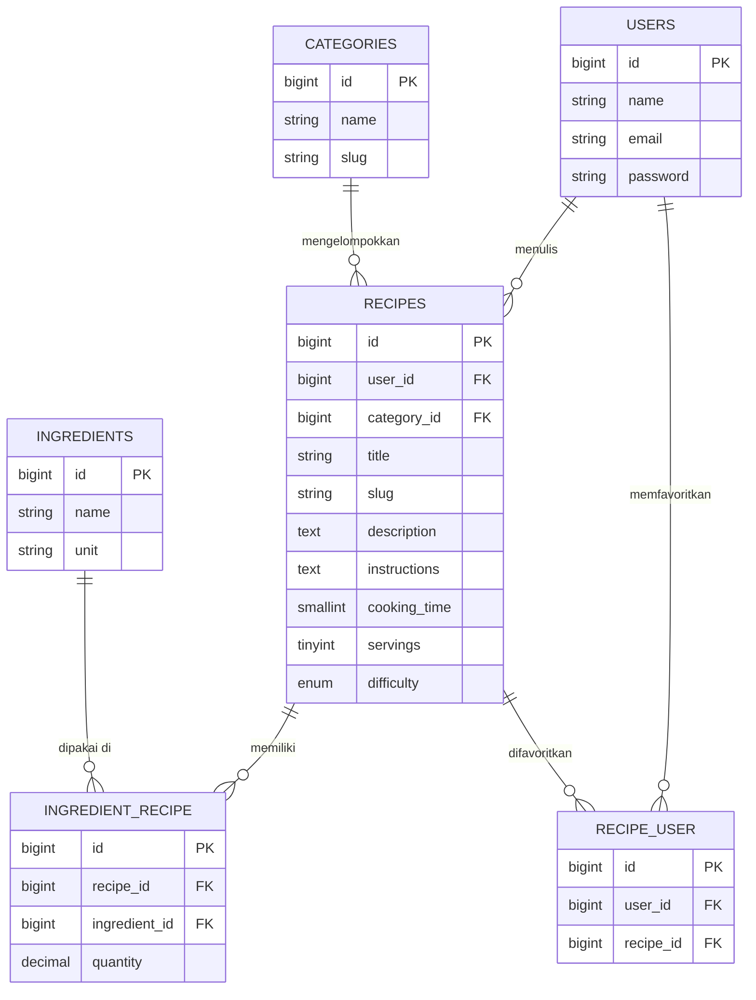

# Progress Report: P01 Database Design

## Identitas

| | |
|---|---|
| Student | Nazwa Aulia Rizka |
| NPM | 2410010338 |
| Class | 5D TI Reguler Banjarbaru |
| Assignment | Assignment 1: Table Relationships: MasakApa |
| Phase | P01: Database Design |
| Status | Done (1 November 2026) |
| Fork / branch | [nazwaaa0805/laravel5d](https://github.com/nazwaaa0805/laravel5d) / `feature/p01-database-design` |

## Ringkasan

Pada fase ini saya merancang dan mengimplementasikan struktur database aplikasi **MasakApa**, yaitu aplikasi untuk membantu pengguna menentukan masakan apa yang akan dibuat. Hasilnya berupa migration, model Eloquent dengan relasi, seeder data contoh, dan dokumentasi ERD.

## Rancangan Tabel

| Tabel | Fungsi | Kolom |
|---|---|---|
| `users` | Pengguna aplikasi (bawaan Laravel) | `id`, `name`, `email`, `password`, dst. |
| `categories` | Kategori masakan | `id`, `name` (unique), `slug` (unique) |
| `ingredients` | Bahan masakan | `id`, `name` (unique), `unit` |
| `recipes` | Resep masakan | `id`, `user_id` (FK), `category_id` (FK, nullable), `title`, `slug` (unique), `description`, `instructions`, `cooking_time`, `servings`, `difficulty` |
| `ingredient_recipe` | Pivot resep dan bahan | `id`, `recipe_id` (FK), `ingredient_id` (FK), `quantity` |
| `recipe_user` | Pivot resep favorit pengguna | `id`, `user_id` (FK), `recipe_id` (FK), `timestamps` |

Aturan foreign key:

- `recipes.user_id` memakai `cascadeOnDelete` (hapus user, resepnya ikut terhapus).
- `recipes.category_id` memakai `nullOnDelete` (hapus kategori, resep tetap ada tanpa kategori).
- Kedua pivot memakai `cascadeOnDelete` dan unique pada pasangan kolom agar tidak ada data ganda.

## Relasi Antar Tabel

| Relasi | Jenis | Eloquent |
|---|---|---|
| User menulis banyak Recipe | One-to-many | `User::recipes()` hasMany, `Recipe::user()` belongsTo |
| Category punya banyak Recipe | One-to-many | `Category::recipes()` hasMany, `Recipe::category()` belongsTo |
| Recipe punya banyak Ingredient | Many-to-many | `Recipe::ingredients()` belongsToMany (pivot: `quantity`) |
| Ingredient dipakai banyak Recipe | Many-to-many | `Ingredient::recipes()` belongsToMany |
| User memfavoritkan banyak Recipe | Many-to-many | `User::favoriteRecipes()` belongsToMany |
| Recipe difavoritkan banyak User | Many-to-many | `Recipe::favoritedBy()` belongsToMany |

## ERD



## Daftar Pekerjaan

| Job | Description | Status |
|---|---|---|
| J1 | Menganalisis kebutuhan data dan menentukan entitas MasakApa | Done |
| J2 | Membuat migration `categories`, `ingredients`, `recipes` | Done |
| J3 | Membuat pivot table `ingredient_recipe` dan `recipe_user` beserta foreign key dan unique constraint | Done |
| J4 | Membuat model `Category`, `Ingredient`, `Recipe` dan menambahkan relasi pada `User` | Done |
| J5 | Membuat seeder data contoh (kategori, bahan, resep, favorit) | Done |
| J6 | Membuat ERD dan dokumentasi desain database | Done |

## Daftar File

| File | Keterangan |
|---|---|
| `database/migrations/2026_11_01_000001_create_categories_table.php` | Tabel kategori |
| `database/migrations/2026_11_01_000002_create_ingredients_table.php` | Tabel bahan |
| `database/migrations/2026_11_01_000003_create_recipes_table.php` | Tabel resep |
| `database/migrations/2026_11_01_000004_create_ingredient_recipe_table.php` | Pivot resep dan bahan |
| `database/migrations/2026_11_01_000005_create_recipe_user_table.php` | Pivot resep favorit |
| `app/Models/User.php` | Relasi `recipes`, `favoriteRecipes` |
| `app/Models/Category.php` | Relasi `recipes` |
| `app/Models/Ingredient.php` | Relasi `recipes` |
| `app/Models/Recipe.php` | Relasi `user`, `category`, `ingredients`, `favoritedBy` |
| `database/seeders/DatabaseSeeder.php` | Memanggil seeder lain dan membuat user contoh |
| `database/seeders/CategorySeeder.php` | 6 kategori |
| `database/seeders/IngredientSeeder.php` | 17 bahan |
| `docs/erd.md` | ERD database (Mermaid) |
| `database/seeders/RecipeSeeder.php` | 5 resep beserta bahan dan favorit |

## Kendala dan Solusi

| Kendala | Solusi |
|---|---|
| Foreign key gagal dibuat jika tabel induk belum ada | Mengurutkan nama file migration: tabel induk (`categories`, `ingredients`) lebih dulu, lalu `recipes`, lalu pivot |
| Nama pivot tidak sesuai konvensi Laravel | Menyebut nama tabel pivot secara eksplisit di `belongsToMany` |

> Catatan: ganti bagian ini dengan kendala yang benar-benar kamu alami.

## Cara Verifikasi

```bash
git checkout feature/p01-database-design
composer install
cp .env.example .env
php artisan key:generate
# atur koneksi database di .env, lalu:
php artisan migrate:fresh --seed
php artisan tinker
```

Cek relasi di tinker:

```php
App\Models\User::first()->recipes;
App\Models\User::first()->favoriteRecipes;
App\Models\Category::first()->recipes;
App\Models\Recipe::with('ingredients', 'category', 'user')->first();
App\Models\Ingredient::first()->recipes;
```

Hasil yang diharapkan: migration dan seeder berjalan tanpa error, dan semua relasi mengembalikan data.

## Belum Dikerjakan

- Controller, route, dan tampilan (fase berikutnya)
- Validasi input dan autentikasi
- Fitur pencarian resep berdasarkan bahan yang tersedia

## Bukti

- ERD: [`docs/erd.md`](https://github.com/nazwaaa0805/laravel5d/blob/feature/p01-database-design/docs/erd.md)
- Migration: [`database/migrations`](https://github.com/nazwaaa0805/laravel5d/tree/feature/p01-database-design/database/migrations)
- Model: [`app/Models`](https://github.com/nazwaaa0805/laravel5d/tree/feature/p01-database-design/app/Models)
- Seeder: [`database/seeders`](https://github.com/nazwaaa0805/laravel5d/tree/feature/p01-database-design/database/seeders)
- Commit: `<tempel link commit di sini>`
